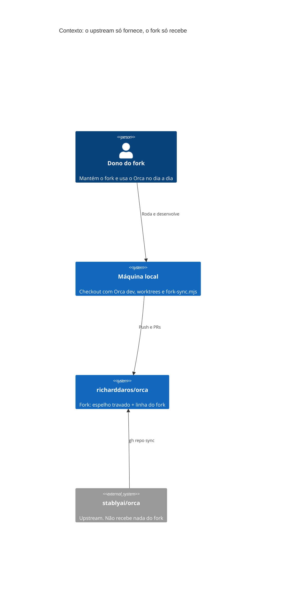
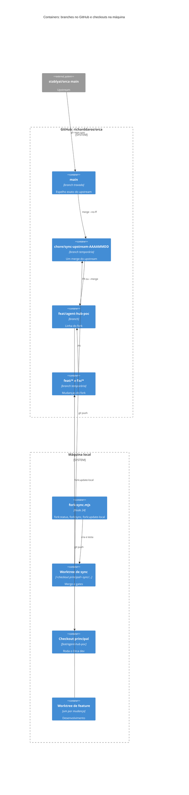
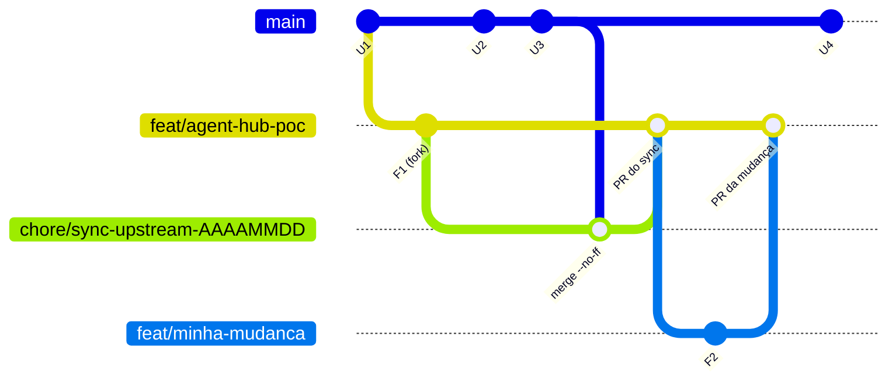
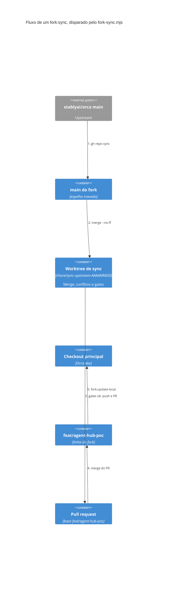
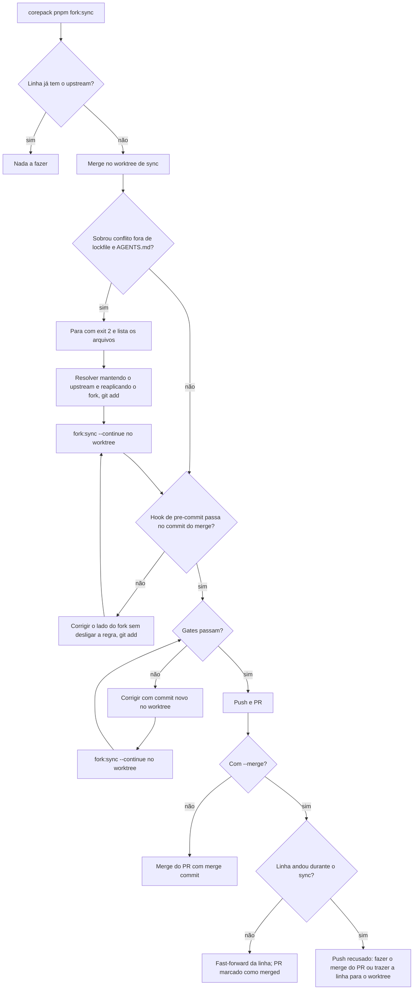

# Sincronização do fork do Orca

`richarddaros/orca` é um fork de `stablyai/orca`. Este runbook mantém o fork
atualizado com o upstream e concentra o trabalho do fork numa única linha.

A regra é simples: o fork **recebe** tudo o que o upstream publica e, por
decisão do dono, **não envia** nada de volta. As mudanças do fork vivem só em
`feat/agent-hub-poc`. Nada impede tecnicamente abrir um PR para o upstream;
isso só acontece por ação manual explícita (ver "Proteções contra envio
acidental ao upstream").

## Visão geral





## Branches

| Branch                         | Papel                                                                         | Quem move                                                   |
| ------------------------------ | ----------------------------------------------------------------------------- | ----------------------------------------------------------- |
| `main`                         | Espelho exato do `main` do upstream. Nunca carrega commits do fork.           | Só `gh repo sync richarddaros/orca --branch main`.          |
| `feat/agent-hub-poc`           | A linha do fork: toda branch do fork, merge, sync e tag `rd/v*` termina aqui. | Pull requests e o push fast-forward do `fork:sync --merge`. |
| `chore/sync-upstream-AAAAMMDD` | Um merge do upstream, revisado como pull request.                             | `fork:sync`.                                                |
| `feat/*`, `fix/*`              | Uma mudança do fork, revisada como pull request contra `feat/agent-hub-poc`.  | Quem desenvolve.                                            |



`main` só recebe commits do upstream (`U*`). A linha recebe o upstream por
merge e as mudanças do fork (`F*`) por PR. Como os commits do fork nunca
entram em `main`, `git diff origin/main...origin/feat/agent-hub-poc` mostra
exatamente o que é do fork.

### Proteção da `main`

`main` é protegida com `lock_branch`, `enforce_admins` e `allow_fork_syncing`,
com force push e deleção desligados. Um push para ela é recusado com
`GH006 ... Cannot change this locked branch`, mesmo com a credencial do dono,
enquanto o botão "Sync fork" do GitHub e o `gh repo sync` continuam fazendo
fast-forward. Para inspecionar ou restaurar a configuração:

```bash
gh api repos/richarddaros/orca/branches/main/protection
gh api -X PUT repos/richarddaros/orca/branches/main/protection --input protection.json
```

onde `protection.json` define `required_status_checks`,
`required_pull_request_reviews` e `restrictions` como `null`; `enforce_admins`,
`lock_branch` e `allow_fork_syncing` como `true`; e `allow_force_pushes` e
`allow_deletions` como `false`.

### Método de merge

O repositório aceita merge commit, squash e rebase. **Num PR de sync, use só
merge commit ou o `fork:sync --merge`.** Squash e rebase descartam o merge do
upstream: a linha recebe o conteúdo, mas os commits do upstream deixam de ser
ancestrais dela. O `fork:status` volta a mostrar esses commits como faltando, e
o próximo sync refaz o merge a partir do ponto antigo.

PRs de mudança do fork (`feat/*`, `fix/*`) podem usar qualquer método.

## Pré-requisitos

- **Node 24.** O `package.json` fixa `engines.node: "24"`, e o `fork:sync` e o
  `fork:update-local` recusam outro Node ou outro pnpm (o `fork:status` não
  confere). Com nvm, rode `nvm use 24` no terminal antes dos comandos.
- **O pnpm fixado no `package.json`, sempre via `corepack pnpm`.** O corepack
  baixa a versão fixada sem trocar a global. Um pnpm diferente reescreve o
  `pnpm-lock.yaml` com uma entrada `@pnpm/exe` que não deve ser commitada.
- **`gh` autenticado na conta `richarddaros`.** O script lê o token dessa conta
  só para o próprio processo e não troca a conta ativa do `gh`.
- **Chave SSH do alias `github-richard`.** O remoto `origin` é
  `git@github-richard:richarddaros/orca.git`, então o `git push` usa esse
  alias do `~/.ssh/config`, não o token do `gh`.

## Comandos

```bash
corepack pnpm fork:status               # atraso do espelho, commits do upstream faltando, atraso do checkout local
corepack pnpm fork:sync                 # sincroniza main, faz o merge num worktree novo, roda os gates, push e abre o PR
corepack pnpm fork:sync --merge         # o mesmo e, no fim, faz fast-forward de feat/agent-hub-poc até o commit do sync
corepack pnpm fork:sync --continue [--merge]  # retoma no worktree de sync; repita --merge se o sync começou com ele
corepack pnpm fork:update-local         # fast-forward deste checkout e reinstalação das dependências
```

## Como o sync funciona





### Worktree isolado

O `fork:sync` nunca mexe no checkout de onde é chamado. Ele cria o worktree de
sync em `<checkout principal>-sync/chore-sync-upstream-AAAAMMDD` e faz o merge
lá, então um Orca dev em execução continua funcionando até o
`fork:update-local` rodar no checkout dele. Se a branch do dia já existir, o
nome ganha o sufixo `-2`, `-3` e assim por diante.

### Conflitos

Dois conflitos se resolvem sozinhos:

- `pnpm-lock.yaml`: fica o lockfile do upstream, trocando só os hashes dos
  patches que o fork alterou (`patch_hash` é o sha256 do arquivo de patch). Os
  hashes são recalculados de novo logo antes do commit do merge, o que cobre um
  patch resolvido à mão, e o `pnpm install --frozen-lockfile` depois comprova o
  resultado.
- `AGENTS.md`: fica o arquivo do upstream mais o bloco entre os marcadores
  `<!-- fork:richarddaros/orca:start -->` e `:end -->`.

Qualquer outro conflito, ou um `AGENTS.md` que um dos lados apagou ou cujo lado
do fork não tem o bloco, para a execução com exit code 2 e a lista de arquivos,
antes de instalar qualquer coisa. Resolva no worktree de sync **mantendo o
comportamento do upstream e reaplicando a mudança do fork**, faça `git add` e
rode `corepack pnpm fork:sync --continue [--merge]` lá. O `--continue` se recusa
a rodar fora de uma branch `chore/sync-upstream-*`.

Para conflitar pouco, deixe o código do fork em módulos próprios e, nos
arquivos do upstream, só uma linha de chamada. Assim o conflito, quando
acontece, fica restrito a essa linha.

### Hook de pre-commit

O commit do merge roda o hook de pre-commit (lint-staged) sobre os arquivos
staged que ele cobre: código e configuração fora de `cloud/`, incluindo
arquivos do upstream. Um merge textual limpo ainda pode falhar no hook,
tipicamente quando as linhas do upstream mais a mudança do fork passam um
arquivo do limite de `max-lines`. A execução então para com a saída do hook e
deixa o merge em andamento. Corrija o lado do fork no worktree de sync sem
desligar a regra, por exemplo movendo o código do fork para um módulo próprio,
faça `git add` e rode `corepack pnpm fork:sync --continue [--merge]`.

### Dependências próprias do fork

Se o fork um dia adicionar uma dependência ou um patch próprio, o lockfile do
upstream não vai tê-lo e o `pnpm install --frozen-lockfile` falha logo depois
do merge. Nesse caso, rode `corepack pnpm install` no worktree de sync, confira
que `git diff pnpm-lock.yaml` só adiciona as entradas do fork, faça `git add` e
continue.

### Gates e PR

Os gates antes do push são `pnpm install --frozen-lockfile`, `pnpm tc`,
`pnpm test:agent-hub`, `pnpm test:fork-sync` e todo `*.test.*` alterado pelo
fork em `src/`, com dois workers. O corpo do PR lista todos os arquivos que
ainda diferem do upstream (devem ser só os do fork) e todos os commits do
upstream que tocaram algum deles, para que cada reaplicação seja revalidada.

A etapa de publicação recusa alterações não commitadas e arquivos não
rastreados, para que os gates testem exatamente o que vai para o push. Quando
um gate falha depois do commit do merge, corrija com um commit novo no worktree
de sync e rode `corepack pnpm fork:sync --continue [--merge]` de novo: a
execução encontra o merge do sync na branch, faz push da correção e atualiza o
corpo do PR que já está aberto.

O `test:fork-sync` cria repositórios Git falsos (origin, upstream e local) em
`<tmp do sistema>/fork-sync-*`, que no Linux normalmente é `/tmp`. Linhas como
`! [rejected] ... fork-sync-*/origin.git` no log vêm desse teste, não do
GitHub.

### Push recusado no `--merge`

Se o `--merge` informar que o push para `feat/agent-hub-poc` foi recusado, a
linha andou depois que o sync começou. Nunca use `git pull` nem force push.
Faça o merge do PR aberto no GitHub com merge commit, ou rode `git fetch origin` e
`git merge --no-ff origin/feat/agent-hub-poc` no worktree de sync e depois
`corepack pnpm fork:sync --continue --merge` de novo; a execução continua
reportando o merge do upstream, não o merge da linha. Se esse merge da linha
conflitar, resolva e faça o commit à mão primeiro: o `--continue` se recusa a aplicar
as resoluções automáticas do upstream num merge que não é do upstream.

## Como criar uma mudança no fork

```bash
corepack pnpm fork:status        # se faltar upstream, rode o fork:sync antes
git fetch --prune origin
git worktree add --no-track -b feat/minha-mudanca <caminho do worktree> origin/feat/agent-hub-poc
cd <caminho do worktree>
corepack pnpm install --frozen-lockfile
# implementar, fazer commit, rodar corepack pnpm tc e os testes tocados
git push -u origin feat/minha-mudanca
gh pr create --repo richarddaros/orca --base feat/agent-hub-poc
```

- Sempre passe `--repo richarddaros/orca --base feat/agent-hub-poc` ao criar o
  PR.
- O fork não tem CI: o GitHub Actions está desligado. Rode `corepack pnpm tc`
  e os testes localmente antes do merge.
- Se um sync entrar enquanto a mudança está aberta, traga a linha com
  `git fetch origin` e `git merge origin/feat/agent-hub-poc` na sua branch.
- Correções que não são específicas do fork saem de uma base do upstream
  (regra do `AGENTS.md`), para poderem ser oferecidas ao upstream se um dia o
  dono decidir. Use o commit do upstream que já está na linha, e não a ponta de
  `origin/main`: entre o `gh repo sync` e o merge do PR de sync, a `main` fica
  à frente da linha, e uma branch cortada dela levaria commits do upstream para
  a linha sem passar pelos gates do sync. O PR delas também vai para
  `feat/agent-hub-poc`.

  ```bash
  git worktree add --no-track -b fix/minha-correcao <caminho do worktree> \
    "$(git merge-base origin/main origin/feat/agent-hub-poc)"
  ```

## Como manter o Orca local atualizado

1. `corepack pnpm fork:sync --merge` a partir de qualquer checkout do
   repositório.
2. No checkout que roda o Orca dev, num momento em que o app pode reiniciar:
   `corepack pnpm fork:update-local`. Ele só faz fast-forward e recusa rodar se
   houver alterações em arquivos rastreados.
3. Reinicie o Orca dev com `corepack pnpm dev`.

O upstream recebe cerca de 150 a 300 commits por dia. Sincronizar a cada um ou
dois dias mantém os conflitos pequenos.

## Proteções contra envio acidental ao upstream

- A conta do fork não tem permissão de push no `stablyai/orca`:
  `gh api repos/stablyai/orca --jq .permissions` mostra `push: false`. Isso
  impede enviar commits, mas não impede abrir um PR: qualquer conta pode abrir
  PR do fork para o repositório pai.
- O clone só tem o remoto `origin`, que aponta para o fork.
- O `gh` deste clone tem o fork como repositório padrão
  (`gh repo set-default --view` mostra `richarddaros/orca`), então
  `gh pr create` abre o PR no fork.
- Cuidado na web: num fork, o botão "Compare & pull request" do GitHub propõe
  `stablyai/orca` como base. Confira o campo "base repository" antes de criar.

## Versões

Marque releases do fork em `feat/agent-hub-poc` com tags anotadas no formato
`rd/v<versão do upstream>-<n>`, por exemplo `rd/v1.4.219-1`. Não use `v*`, que
colide com as tags do upstream, nem `mobile-*-v*`, que os workflows de release
do upstream capturam. Como o GitHub Actions está desligado no fork, tags
enviadas não disparam nenhum workflow.

## Recuperação

| Situação                                | O que fazer                                                                                                                                                                                         |
| --------------------------------------- | --------------------------------------------------------------------------------------------------------------------------------------------------------------------------------------------------- |
| Desistir de um sync ainda não publicado | O worktree de sync é descartável: `git worktree remove <caminho>` e `git branch -D <branch>`, com caminho e branch como aparecem em `git worktree list`.                                            |
| Desfazer um sync já mergeado            | Ele é um único merge commit em `feat/agent-hub-poc`: `git revert -m 1 <sha>` numa branch nova e PR. Nunca use reset nem force push na linha.                                                        |
| O build novo do Orca local deu problema | O `fork:update-local` só faz fast-forward: `git switch --detach ORIG_HEAD` e `corepack pnpm install --frozen-lockfile` rodam o commit anterior; `git switch feat/agent-hub-poc` volta para a linha. |
| `pnpm-lock.yaml` alterado sem motivo    | Normalmente é a entrada `@pnpm/exe` de um pnpm não fixado. Confira com `git diff`; se for só essa entrada, descarte com `git restore pnpm-lock.yaml`.                                               |
